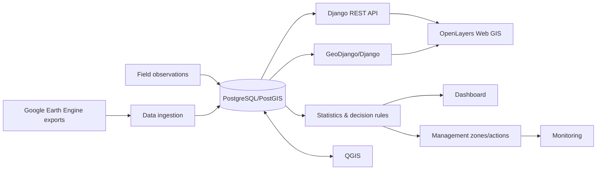

# Architecture

Core principle: Oloolua is a `Forest` record, not a separate application.

Analytical principle: every forest has a `ForestProfile` methodology contract. The Oloolua profile records the supplied GEE workflow, including epochs, sensors, CRS, native and derived scales, class schema, training/validation split, and scientific limitations. Future forest analyses must provide their own profile values rather than inheriting Oloolua assumptions.
